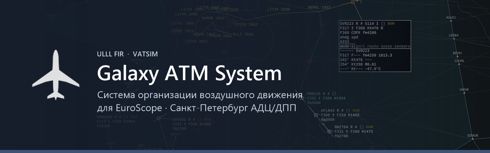

  

  
  
  

**Galaxy ATM System** — комплекс средств автоматизации для диспетчеров РПИ Санкт-Петербург (ULLL) в сети VATSIM: плагин EuroScope с привычной диспетчеру индикацией, лаунчер, который ставит и обновляет всё в один клик, и общий сервер, который держит единое состояние для всех позиций.

### Что умеет

- 🛰️ **Формуляры и метки** воздушных судов, списки секторов, координация между соседними позициями
- ⚠️ **Предупреждение о конфликтах** (STCA) и о входе в зоны ограничений — с данными NOTAM, AUP и SIGMET
- 📡 **Коды ответчика** выдаются сервером и не повторяются между диспетчерами
- 🧭 **Радиопеленгатор** по данным AFV, ATIS и METAR прямо на экране
- 🚀 **Лаунчер**: профили EuroScope, шрифты, секторы, обновления и запуск одной кнопкой

### Репозитории

| | Репозиторий | Что внутри |
|---|---|---|
| 🧩 | **galaxy-plugin** | Плагин EuroScope (C++, Win32), лаунчер и установщик — исходный код |
| 🚀 | [**galaxy-launcher**](https://github.com/Galaxy-ATM-for-ULLL/galaxy-launcher) | Публичные выпуски лаунчера — [скачать последнюю версию](https://github.com/Galaxy-ATM-for-ULLL/galaxy-launcher/releases/latest) |
| 🌐 | **galaxy-server** | Сайт [galaxy-atm.ru](https://galaxy-atm.ru), API плагина и лаунчера, сервер кодов |

### Как начать

Скачайте лаунчер на [galaxy-atm.ru](https://galaxy-atm.ru) или со [страницы выпусков](https://github.com/Galaxy-ATM-for-ULLL/galaxy-launcher/releases/latest), пройдите регистрацию в КСА и войдите в сеть VATSIM на позиции ULLL — лаунчер сам установит плагин, шрифты и секторы.

---

Galaxy ATM System — проект для виртуальной авиации (EuroScope / VATSIM). Не предназначен для реального управления воздушным движением и не связан с организациями реальной авиации.
